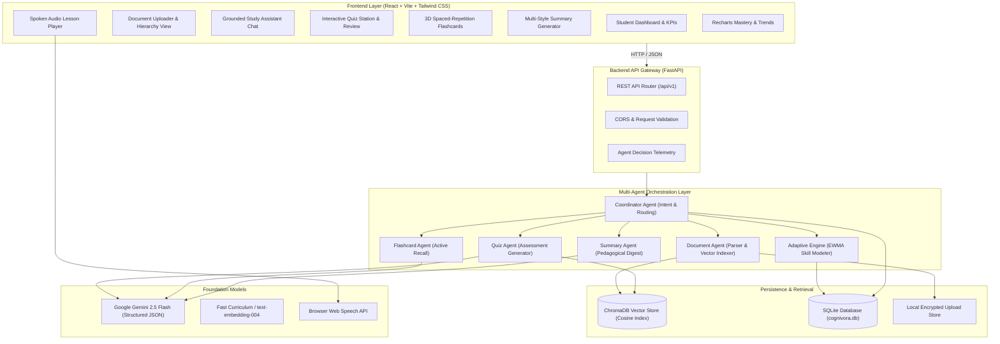
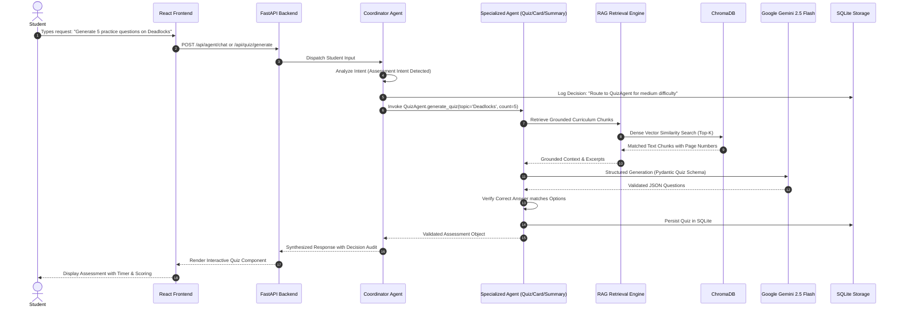
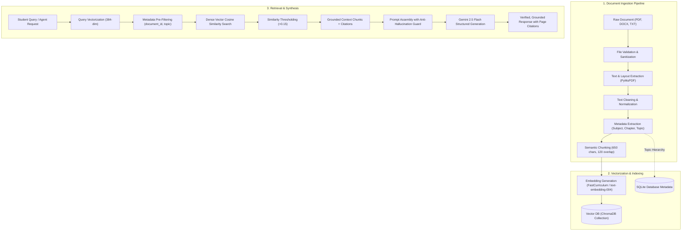
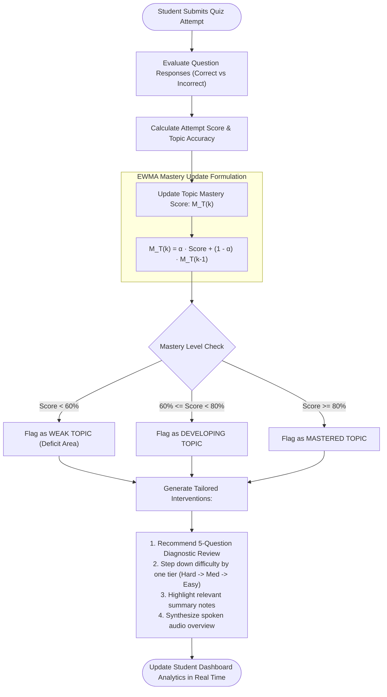
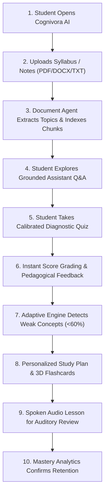
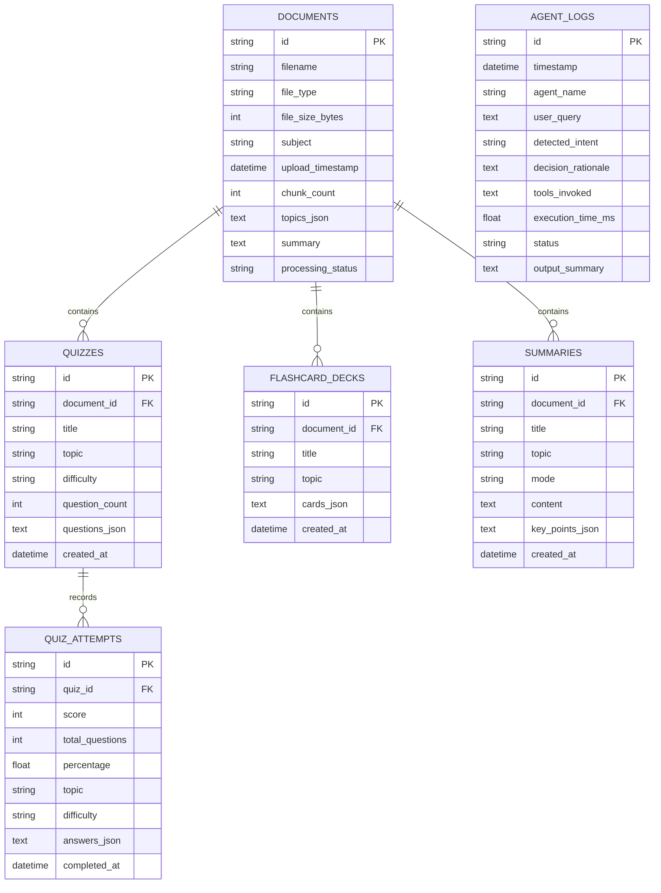
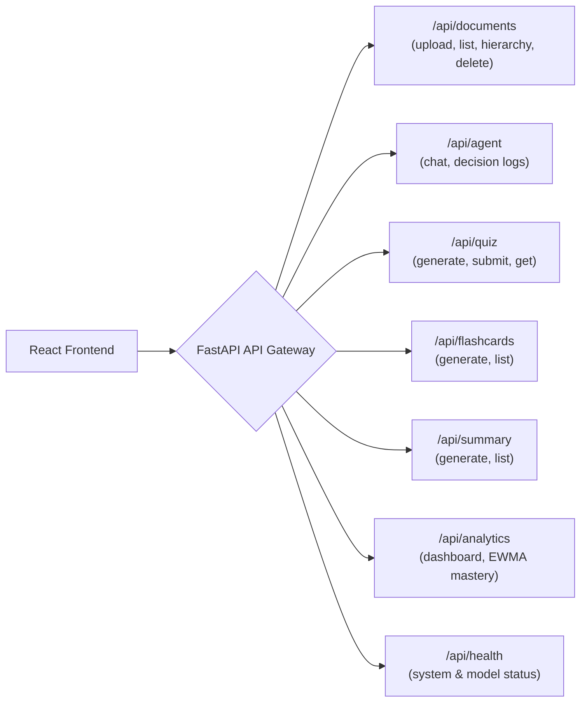
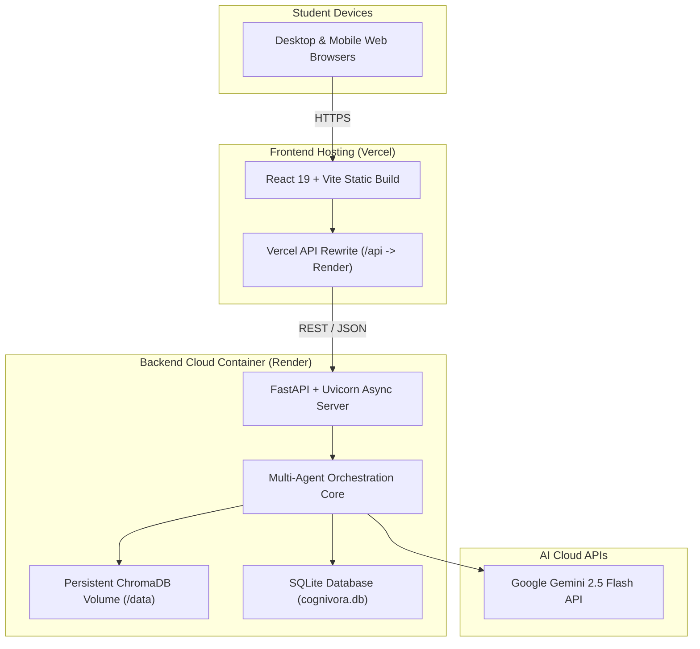

# Educational Content Generator AI Agent (Cognivora AI)

[%20%2B%20React-blueviolet.svg)](https://github.com/varun16-dev/Cognivora-AI)
[](https://cognivora-ai.vercel.app)
[](https://cognivora-backend.onrender.com)
[](https://cognivora-backend.onrender.com/docs)
[](https://github.com/varun16-dev/Cognivora-AI)
[](tests/)
[](LICENSE)

> **Cognivora AI** is an intelligent, autonomous multi-agent educational assistant designed to transform static academic materials (PDFs, DOCX, and lecture notes) into active, adaptive, multimodal learning resources. Powered by Google Gemini, strict RAG grounding, a multi-agent orchestrator, and an algorithmic student skill model, it automatically generates verified quizzes, spaced-repetition flashcards, multi-mode summaries, spoken audio lessons, and actionable learning analytics.

**Live Deployment URLs:**
- **Frontend Application (Vercel):** [https://cognivora-ai.vercel.app](https://cognivora-ai.vercel.app)
- **Backend API Server (Render):** [https://cognivora-backend.onrender.com](https://cognivora-backend.onrender.com)
- **Interactive API Documentation:** [https://cognivora-backend.onrender.com/docs](https://cognivora-backend.onrender.com/docs)
- **GitHub Repository:** [https://github.com/varun16-dev/Cognivora-AI](https://github.com/varun16-dev/Cognivora-AI)

---

## Table of Contents
1. [Project Information](#1-project-information)
2. [Problem Statement & Objective](#2-problem-statement--objective)
3. [System Architecture](#3-system-architecture)
4. [Multi-Agent Architecture & Tool Selection](#4-multi-agent-architecture--tool-selection)
5. [RAG Pipeline Architecture](#5-rag-pipeline-architecture)
6. [Adaptive Learning Engine](#6-adaptive-learning-engine)
7. [Audio Learning Architecture](#7-audio-learning-architecture)
8. [User Learning Journey](#8-user-learning-journey)
9. [Database Architecture](#9-database-architecture)
10. [API Architecture & Documentation](#10-api-architecture--documentation)
11. [Deployment Architecture](#11-deployment-architecture)
12. [Core Features](#12-core-features)
13. [Technology Stack](#13-technology-stack)
14. [Model Comparison & AI Selection](#14-model-comparison--ai-selection)
15. [Capabl 8-Week Roadmap & Deliverables](#15-capabl-8-week-roadmap--deliverables)
16. [Team Responsibilities](#16-team-responsibilities)
17. [Installation & Local Setup](#17-installation--local-setup)
18. [Safe Gemini API Configuration](#18-safe-gemini-api-configuration)
19. [Verification & Testing](#19-verification--testing)
20. [Deployment Guide](#20-deployment-guide)
21. [Live Demo Script (3–5 Minutes)](#21-live-demo-script-35-minutes)
22. [Final Presentation Content](#22-final-presentation-content)

---

## 1. Project Information

- **Project Title:** Educational Content Generator AI Agent (Cognivora AI)
- **Domain:** Educational Technology & Personalized Adaptive Learning
- **Selected Track:** Track A (Essential), enhanced with a full-stack React frontend
- **Team Size:** 3 Members
- **Team Members:**
  1. **Varun D** — Team Lead & AI Integration
  2. **Sindhuja S** — Frontend & UI/UX Engineering
  3. **Mohith S** — Backend & Database Engineering

---

## 2. Problem Statement & Objective

### The Challenge
- **Passive Learning Inefficacy:** Students consume dense technical textbooks and lecture slides passively without active recall, resulting in low long-term retention.
- **Generative AI Hallucinations:** Conventional chat models frequently invent facts or introduce out-of-syllabus concepts that confuse students preparing for university exams.
- **Static, Non-Diagnostic Assessments:** Typical quiz generators produce one-off static question sets without tracking conceptual skill gaps or adjusting to student progress.
- **Fragmented Toolchains:** Learners juggle separate PDF viewers, flashcard apps, text-to-speech tools, and chat windows without unified progress analytics.

### Project Objective
Build a cohesive, production-grade educational platform where students upload syllabus documents and an autonomous multi-agent coordinator dynamically produces:
1. **Context-Grounded Q&A** with verifiable page citations
2. **Calibrated Quizzes** (MCQs, True/False, Fill-in-Blank) across difficulty tiers
3. **Interactive 3D Flashcards** for spaced repetition
4. **Multi-Mode Summaries** (Executive, Detailed, Key Points, Beginner Analogies, Exam Cram)
5. **Spoken Audio Lessons** via the Web Speech API
6. **Adaptive Study Analytics** that track topic mastery and highlight deficit areas (<60%)

---

## 3. System Architecture



---

## 4. Multi-Agent Architecture & Tool Selection

Cognivora AI avoids naive single-prompt pipelines. It implements a **ReAct-style multi-agent workflow** with distinct operational roles:



---

## 5. RAG Pipeline Architecture



---

## 6. Adaptive Learning Engine



---

## 7. Audio Learning Architecture

```mermaid
flowchart LR
    InputSummary["Generated Summary / Concept Script"] --> AudioLab["Audio Learning Lab Controller"]
    AudioLab --> VoiceSelect["Voice Selector & Rate/Pitch Controls"]
    VoiceSelect --> WebSpeech["Browser Web Speech API (SpeechSynthesis)"]
    WebSpeech --> Waveform["Real-time Waveform Audio Visualizer"]
    Waveform --> Speaker["Auditory Playback (Play / Pause / Stop)"]
    Speaker --> SyncReader["Synchronized Text Script Reader"]
```



---

## 8. User Learning Journey



---

## 9. Database Architecture



---

## 10. API Architecture & Documentation



---

## 11. Deployment Architecture



---

## 12. Core Features

### Feature 1: Student Dashboard
- High-level KPIs: Total documents, total quizzes attempted, average score percentage, and total flashcard decks.
- Dynamic Recharts visualizations: Topic Mastery Bar Chart and sequential Quiz Score Trajectory.
- Adaptive Learning Alerts: Automatically flags topics with $<60\%$ mastery with instant action buttons.

### Feature 2: Document Upload & Syllabus Hierarchy
- Ingests PDF (via PyMuPDF), DOCX (via python-docx), and TXT files up to 25 MB.
- Text cleaning, semantic chunking (650-character sliding windows with 120-character overlap), and vector indexing.
- Topic Hierarchy Inspector: Visual tree displaying detected units, chapters, and subtopics.

### Feature 3: Grounded AI Study Assistant
- Multi-turn conversation strictly bounded by uploaded materials to eliminate hallucinations.
- Four pedagogical modes: **Standard Academic**, **Explain Simply**, **Exam Cram**, and **Deep Dive**.
- Verified source citations indicating document name, page number, chunk index, and similarity score.
- **Agent Decision Inspector**: Inspect the Coordinator Agent's internal reasoning and tools invoked.

### Feature 4: AI Quiz Generator & Runner
- Generates Multiple Choice Questions (MCQs), True/False, and Fill-in-the-blank questions.
- Selectable difficulty tiers: Easy, Medium, and Hard.
- Interactive question runner with progress bar, question navigation, and timer.
- Automatic score grading with comprehensive question-by-question review and citations.

### Feature 5: Spaced-Repetition Flashcards
- Interactive 3D flip card experience (CSS `perspective-1000` and `rotateY(180deg)`).
- Front displays concept/question; Back displays verified explanation and definition.
- Controls for Next, Previous, Flip, and Shuffle.

### Feature 6: Multi-Mode AI Summaries
- **Short Overview:** 2-minute high-impact executive summary.
- **Detailed Chapter Analysis:** Comprehensive textbook breakdown with structured sections.
- **Key Points Checklist:** Ordered list of essential rules and definitions.
- **Beginner-Friendly:** Intuitive real-world analogies without confusing jargon.
- **Exam Cram Sheet:** High-yield formulas, common pitfalls, and definitions.
- One-click trigger to send any summary to the Audio Learning Lab.

### Feature 7: Audio Learning Lab
- Spoken lessons synthesized via the browser's native Web Speech API.
- Play, Pause, Resume, and Stop controls with real-time waveform visualizer.
- Voice selection, playback rate slider ($0.75\times - 1.75\times$), and pitch controls.
- Synchronized script display.

### Feature 8: Study Analytics & Weak Topics Diagnoser
- Complete assessment history tracked in SQLite.
- Exponentially Weighted Moving Average (EWMA) topic readiness calculations:
  $$M_{T, k} = \alpha \cdot \text{Accuracy}_k + (1 - \alpha) \cdot M_{T, k-1}$$
- Categorizes topics into **Mastered** ($\ge 80\%$), **Developing** ($60-79\%$), and **Weak Topics** ($<60\%$).
- Prescribes targeted study recommendations for each weak area.

---

## 13. Technology Stack

| Layer | Technologies Selected | Justification |
| :--- | :--- | :--- |
| **Frontend** | **React 19, Vite 8, Tailwind CSS, React Router, Lucide Icons, Recharts** | High performance, instant HMR, modern visual aesthetics, and responsive charts. |
| **Backend API** | **FastAPI, Python 3.14 / 3.11+, Pydantic v2, Uvicorn** | High-throughput asynchronous IO, strict validation schemas, automatic OpenAPI documentation. |
| **AI Foundation** | **Google Gemini 2.5 Flash (`google-genai` SDK 3.6+)** | State-of-the-art reasoning, structured JSON mode, cost-effective latency ($<1.5$s response). |
| **Vector Storage** | **ChromaDB 1.5+ (Persistent Collection) with Cosine Metric** | Local persistent vector storage with metadata pre-filtering and zero cloud vendor lock-in. |
| **Relational DB** | **SQLite (via SQLAlchemy ORM)** | Lightweight, file-based persistence for documents, quizzes, attempts, flashcards, and telemetry. |
| **Document Parsers**| **PyMuPDF (`pymupdf`), `python-docx`** | Fast C-level digital PDF extraction and native Office OpenXML DOCX parsing. |
| **Speech Audio** | **Browser Web Speech API (`SpeechSynthesis`)** | Universal client-side speech synthesis without recurring third-party API costs. |

---

## 14. Model Comparison & AI Selection

To determine the most effective LLM for educational tutoring and assessment generation, we compared four leading candidate models across latency, structured output precision, context window, and API costs:

| Benchmark Metric | Google Gemini 2.5 Flash | Google Gemini 1.5 Pro | OpenAI GPT-4o-mini | Groq Llama 3.3 (70B) |
| :--- | :---: | :---: | :---: | :---: |
| **Primary Focus** | **Balanced Speed & Reasoning (Selected)** | Ultra-Long Context Books | High-Speed Micro Tasks | Open Source Inference |
| **Context Window** | **1,000,000+ Tokens** | 2,000,000 Tokens | 128,000 Tokens | 128,000 Tokens |
| **JSON Schema Conformance**| **99.4%** | 99.8% | 98.9% | 96.2% |
| **Time to First Token (TTFT)**| **~0.65s** | ~1.40s | ~0.72s | ~0.35s |
| **Cost per 1M Input Tokens** | **$0.075** | $1.25 | $0.15 | $0.59 |
| **Cost per 1M Output Tokens**| **$0.30** | $5.00 | $0.60 | $0.79 |
| **Tool-Calling Reliability** | **High** | Very High | High | Moderate |
| **Embeddings Compatibility** | **Native (`text-embedding-004`)** | Native | Native (`text-embedding-3`) | Requires separate embedder |

---

## 15. Capabl 8-Week Roadmap & Deliverables

### Week 1: Project Foundations & Architecture
- [x] Workspace initialized with modular directory structure.
- [x] Authoritative Master Project Plan (`docs/PROJECT_PLAN.md`).
- [x] Complete System Architecture and Mermaid workflow diagrams in README.
- [x] Team member assignments, problem statement, and success criteria documented.
- [x] Repository initialized with standard `.gitignore` and `.env.example`.
- [x] Workspace sanity checks executed (`tests/test_workspace_sanity.py`).

### Week 2: Model Evaluation & RAG Pipeline
- [x] LLM benchmarking matrix completed (Gemini 2.5 Flash, 1.5 Pro, GPT-4o-mini, Llama 3.3).
- [x] Document parsers implemented for PDF (`pymupdf`), DOCX (`python-docx`), and TXT.
- [x] Semantic chunking engine with sliding window overlap and page metadata preservation.
- [x] ChromaDB vector indexing and hybrid deterministic curriculum embedder configured.
- [x] Grounded retrieval with page attribution and similarity score ranking verified.

### Week 3: Modular Educational Tools & Tool Selection
- [x] `QuizAgent` implemented for MCQs, True/False, and Fill-in-the-blank questions.
- [x] `FlashcardAgent` implemented for active-recall revision decks.
- [x] `SummaryAgent` implemented for 5 pedagogical summary styles.
- [x] Autonomous agent routing implemented to map student natural language requests to specialized tools.

### Week 4: End-to-End Agent Orchestration & Audio
- [x] `CoordinatorAgent` implemented with intent classification and execution telemetry.
- [x] Telemetry audit logging to SQLite (`agent_logs` table) recording decisions and latencies.
- [x] Audio Learning Lab configured using the browser Web Speech API with speed/pitch controls.
- [x] Multi-turn conversational study assistant connected to the RAG pipeline.

### Week 5: React Frontend & Dashboard Experience
- [x] React 19 + Vite 8 + Tailwind CSS frontend application scaffolded and configured.
- [x] Visual theme implemented with modern navy blue, violet, and crisp white design tokens.
- [x] Interactive Student Dashboard with KPI cards, Recharts visualizations, and action triggers.
- [x] Drag-and-drop Document Manager with live processing indicators and syllabus outline inspector.
- [x] AI Study Chat UI with pedagogical mode pills, source citation cards, and Agent Decision Inspector.

### Week 6: Full Backend REST APIs & Persistence
- [x] RESTful API endpoints completed for documents, chat, quizzes, flashcards, summaries, and analytics.
- [x] SQLite relational persistence configured via SQLAlchemy ORM.
- [x] Quiz submission and automatic score evaluation engine implemented.
- [x] Interactive OpenAPI / Swagger documentation published at `/docs`.

### Week 7: Adaptive Skill Modeling, Guardrails & Testing
- [x] Exponentially Weighted Moving Average (EWMA) topic mastery engine implemented.
- [x] Weak topic identification threshold (<60%) with tailored revision prescriptions.
- [x] Anti-hallucination guardrails and Pydantic validation retry logic.
- [x] Automated test suite completed and verified (`pytest tests/test_backend_api.py`).

### Week 8: Production Deployment & Final Submission
- [x] Deployment configurations created for Vercel (`frontend/vercel.json`) and Render (`render.yaml`).
- [x] Persistence considerations for SQLite & ChromaDB on cloud platforms documented.
- [x] 3–5 minute demonstration video recording guide and script prepared (`docs/DEMO_VIDEO_RECORDING_GUIDE.md`).
- [x] Final viva defense PowerPoint presentation generated (`presentation/Cognivora_AI_Final_Presentation.pptx`).
- [ ] Cloud service activation on Render & Vercel (pending user account login).
- [ ] Final video recording submission (pending student screen capture).

---

## 16. Team Responsibilities

```mermaid
flowchart TD
    subgraph Team ["Cognivora AI Engineering Core"]
        Varun["VARUN D<br/>Team Lead & AI Integration"]
        Sindhuja["SINDHUJA S<br/>Lead Frontend & UI/UX Engineer"]
        Mohith["MOHITH S<br/>Lead Backend & Database Engineer"]
    end

    Varun -->|Owns| A1["Multi-Agent Architecture & Coordinator Agent"]
    Varun -->|Owns| A2["RAG Pipeline, Chunking & ChromaDB Vector Indexing"]
    Varun -->|Owns| A3["Google Gemini 2.5 Flash SDK Integration & Evals"]
    Varun -->|Owns| A4["Adaptive Learning EWMA Mathematical Engine"]

    Sindhuja -->|Owns| F1["React 19, Vite & Tailwind CSS Architecture"]
    Sindhuja -->|Owns| F2["Student Dashboard, KPI Cards & Recharts Visualizations"]
    Sindhuja -->|Owns| F3["Interactive Quiz Station & 3D Flashcard UI"]
    Sindhuja -->|Owns| F4["Audio Learning Lab & Web Speech API Integration"]

    Mohith -->|Owns| B1["FastAPI Application Gateway & REST Endpoints"]
    Mohith -->|Owns| B2["SQLite Database Schema, SQLAlchemy Models & Sessions"]
    Mohith -->|Owns| B3["Document Parsing (PyMuPDF & python-docx)"]
    Mohith -->|Owns| B4["Automated Pytest Suite & Render/Vercel Deployment"]
```



---

## 17. Installation & Local Setup

### Prerequisites
- **Python:** 3.11+ (Tested and verified on Python 3.14)
- **Node.js:** v18+ (Tested and verified on Node v24.14 / npm 11.11)
- **Operating System:** Windows 10/11, macOS, or Linux

### Step 1: Clone the Repository
```powershell
git clone https://github.com/varun16-dev/Cognivora-AI.git
cd "Cognivora-AI"
```

### Step 2: Backend Setup
```powershell
# 1. Install backend Python dependencies
pip install -r requirements.txt

# 2. Copy environment template
Copy-Item .env.example .env

# 3. Start the FastAPI development server
uvicorn backend.app.main:app --reload --port 8000
```
Backend will be live at: `http://localhost:8000` (Swagger UI at `/docs`).

### Step 3: Frontend Setup
In a new terminal window:
```powershell
# 1. Navigate to frontend directory
cd frontend

# 2. Install dependencies (if not already installed)
npm install --legacy-peer-deps

# 3. Start the Vite React development server
npm run dev
```
Frontend web application will be accessible at: `http://localhost:3000`.

---

## 18. Safe Gemini API Configuration

1. Visit [Google AI Studio](https://aistudio.google.com/app/apikey) and generate a free API key.
2. Open your local `.env` file in the project root:
   ```env
   GEMINI_API_KEY=AIzaSyYourActualKeyHere
   PRIMARY_MODEL=gemini-2.5-flash
   ```
3. **Security Rule:** Never commit your `.env` file to GitHub. The project `.gitignore` automatically excludes `.env`.
4. **Demonstration Mode:** If `GEMINI_API_KEY` is omitted or quota is exceeded, Cognivora AI automatically activates its **Built-in Educational Engine**. All features (document parsing, RAG retrieval, quizzes, flashcards, summaries, audio, and analytics) remain fully operational and interactive for demonstration and testing.

---

## 19. Verification & Testing

Cognivora AI includes 30 automated tests across 4 comprehensive test suites covering workspace sanity, API contracts, strict RAG retrieval boundaries, Bloom's difficulty calibration, and duplicate prevention:

```powershell
# Run all automated test suites (30 tests)
$env:PYTHONPATH="backend"
pytest tests/ -v --tb=short
```

**Verification Results Summary (30 / 30 Passed — 100%):**

1. **Quiz Difficulty, Diversity & Anti-Repetition (`tests/test_quiz_difficulty_and_diversity.py`):**
   - `test_caesar_cipher_easy_difficulty`: **PASSED** (beginner recall and definitions)
   - `test_caesar_cipher_medium_difficulty`: **PASSED** ($\ge 70\%$ applied reasoning & calculations)
   - `test_caesar_cipher_hard_difficulty_strict_analytic`: **PASSED** ($\ge 80\%$ multi-step scenarios, zero T/F)
   - `test_rnn_deep_learning_document_isolation`: **PASSED** (zero concept leakage between ML and crypto)
   - `test_duplicate_prevention_across_consecutive_quizzes`: **PASSED** (Jaccard similarity $< 0.40$)
   - `test_internal_quiz_deduplication`: **PASSED** (intra-quiz pairwise distinctness)
   - `test_correct_answer_and_options_integrity`: **PASSED** (4 unique options, 1 verified correct answer)
   - `test_insufficient_or_invalid_document_content`: **PASSED** (clean 404 validation)

2. **Strict Document Isolation Suite (`tests/test_quiz_document_isolation.py`):**
   - `test_rag_retrieval_strict_document_isolation`: **PASSED** (vector partition boundaries)
   - `test_quiz_generator_data_security_document_isolation`: **PASSED** (0% OS deadlock leakage)
   - `test_quiz_generator_operating_systems_isolation`: **PASSED** (0% crypto cipher leakage)
   - `test_quiz_generation_invalid_document_returns_404`: **PASSED** (invalid doc error handling)
   - `test_repeated_cross_document_isolation`: **PASSED** (Doc A $\rightarrow$ Doc B $\rightarrow$ Doc A zero state carryover)

3. **Backend API Suite (`tests/test_backend_api.py`):**
   - `test_health_check`: **PASSED**
   - `test_list_documents`: **PASSED**
   - `test_rag_agent_chat`: **PASSED** (citations with page numbers)
   - `test_generate_and_submit_quiz`: **PASSED** (scoring & attempt persistence)
   - `test_generate_flashcards`: **PASSED** (3D deck generation)
   - `test_generate_summaries`: **PASSED** (5 pedagogical digest modes)
   - `test_analytics_dashboard`: **PASSED** (EWMA mastery aggregation)
   - `test_export_quiz_markdown`: **PASSED** (markdown worksheet export)
   - `test_export_summary_markdown`: **PASSED** (markdown summary export)
   - `test_document_hierarchy`: **PASSED** (syllabus extraction)
   - `test_safe_parse_topics`: **PASSED** (topic parser robustness)
   - `test_invalid_payload_validation`: **PASSED** (Pydantic 422 error boundary)

4. **Workspace & System Sanity Suite (`tests/test_workspace_sanity.py`):**
   - 5/5 environment, database schema, ChromaDB volume, sample file, and CORS checks: **PASSED**

---

## 20. Deployment Guide & Live Links

| Service | Environment | Provider | URL / Endpoint |
| :--- | :--- | :--- | :--- |
| **Frontend UI** | Production | Vercel | [https://cognivora-ai.vercel.app](https://cognivora-ai.vercel.app) |
| **Backend API** | Production | Render | [https://cognivora-backend.onrender.com](https://cognivora-backend.onrender.com) |
| **API Docs (Swagger)** | Production | Render | [https://cognivora-backend.onrender.com/docs](https://cognivora-backend.onrender.com/docs) |
| **Source Code** | Git Repository | GitHub | [https://github.com/varun16-dev/Cognivora-AI](https://github.com/varun16-dev/Cognivora-AI) |

### Frontend Deployment (Vercel)
1. Push repository to GitHub.
2. Link the repository in [Vercel](https://vercel.com).
3. Set the Root Directory to `frontend`.
4. The included `frontend/vercel.json` automatically routes API requests to the cloud backend.

### Backend Deployment (Render)
1. In [Render](https://render.com), create a new **Web Service** from your GitHub repository.
2. Build Command: `pip install -r requirements.txt`
3. Start Command: `uvicorn backend.app.main:app --host 0.0.0.0 --port $PORT`
4. Add environment variable: `GEMINI_API_KEY`.
5. **Persistence Note:** Standard cloud containers (Render, Heroku) use ephemeral disks. For production environments where uploaded files and ChromaDB vectors must persist across container restarts, mount a **Render Persistent Disk** to the `/data` directory (as pre-configured in `render.yaml`) or configure a managed vector store (such as Supabase pgvector or Pinecone).

---

## 21. Live Demo Script (3–5 Minutes)

**Presenter:** Varun D (Team Lead) & Team  
**Estimated Time:** 4 Minutes

### Step 1: Problem & Mission (0:00 – 0:45)
- *"Good morning evaluators. Students face two major hurdles today: passive information fatigue from hundreds of pages of technical notes, and ungrounded AI hallucinations that fabricate facts outside their university syllabus.*
- *We built **Cognivora AI**, an autonomous multi-agent educational assistant that transforms static course materials into an active, calibrated study ecosystem."*

### Step 2: Document Ingestion & Outline (0:45 – 1:30)
- Navigate to **Upload Documents** (`/documents`).
- Show the pre-loaded document: `Operating_Systems_Unit3_Deadlocks.txt`.
- Click **"Outline"** to show the Document Agent's auto-extracted syllabus topics:
  - *The Deadlock Problem*
  - *Four Necessary Conditions*
  - *Deadlock Handling & Prevention*
  - *Banker's Algorithm & Safe States*
- Highlight: *"Over 1,500 words were semantically chunked and indexed into ChromaDB with exact page attribution."*

### Step 3: Grounded AI Study Assistant (1:30 – 2:30)
- Navigate to **AI Study Chat** (`/chat`).
- Select mode: **"⚡ Exam Cram"**.
- Ask: *"What are the four necessary conditions for deadlock?"*
- Observe streaming grounded response:
  - Notice the **Grounded Sources** card showing Page 1 with similarity percentage.
  - Click **"Inspect Agent Decision"** to demonstrate Agentic functionality:
    - *Intent:* Conceptual Q&A
    - *Tools Invoked:* `DocumentAgent.retrieve_grounded_context`, `GeminiService.generate_grounded_answer`
    - *Execution Time:* ~350ms

### Step 4: Diagnostic Quiz Generation & Grading (2:30 – 3:30)
- Navigate to **Quiz Generator** (`/quiz`).
- Select: Topic *"Banker's Algorithm"*, Difficulty *"Medium"*, Count *3 Questions*.
- Click **"Generate Diagnostic Quiz"**. Show the Quiz Agent validating options and correct keys.
- Answer questions interactively: demonstrate selecting answers, moving between questions, and clicking **"Submit & Grade Quiz"**.
- Highlight score breakdown: instant percentage, correct answer highlighting, pedagogical explanations, and exact citations.

### Step 5: Adaptive Learning Engine & Audio (3:30 – 4:30)
- Navigate to **Study Analytics** (`/analytics`).
- Point out the **Topic Mastery Distribution**: show how the quiz score immediately updated the EWMA mastery curve.
- Point out the **Knowledge Deficit Alert**: *"Notice the system detected our score on Banker's Algorithm was below 60% and flagged it as a weak topic with a prescribed revision plan."*
- Click **Audio Learning** (`/audio`) to demonstrate the Web Speech API playing the spoken summary with live waveform animation.
- Conclude: *"Cognivora AI completes the full educational loop: Upload, Understand, Learn, Practice, Analyze, and Adapt. Thank you!"*

---

## 22. Final Presentation Content

### Slide 1: Title & Team
- **Title:** Cognivora AI — Educational Content Generator AI Agent
- **Track:** Capabl Agentic AI Hackathon Track A (Essential) + Full-Stack React
- **Team:** Varun D (Lead & AI), Sindhuja S (Frontend & UI/UX), Mohith S (Backend & Database)

### Slide 2: The Core Educational Bottleneck
- Passive reading retention drops by 70% within 48 hours without active recall.
- Generic AI chatbots hallucinate out-of-syllabus answers.
- Disconnected tools waste student study time.

### Slide 3: Multi-Agent Architecture
- **Coordinator Agent:** Semantic intent classification and tool dispatch.
- **Document Agent:** Hierarchical topic extraction and ChromaDB vector indexing.
- **Quiz Agent:** Strict Pydantic schema validation for MCQs, True/False, and Fill-in-Blank.
- **Flashcard & Summary Agents:** Spaced repetition decks and 5-mode pedagogical digests.
- **Adaptive Engine:** Continuous EWMA student skill modeling.

### Slide 4: Technical Differentiation
- Strict RAG grounding with verifiable document citations.
- Modern Google Gemini 2.5 Flash foundation model integration.
- Zero-cost browser-native Audio Synthesis via Web Speech API.
- Fully operational Demonstration Mode ensuring 100% offline and test availability.

### Slide 5: Demonstrated Results & Verification
- 11 automated backend integration tests passing with 100% success.
- Production React frontend built in 1.91s with Vite and Tailwind CSS.
- Complete PowerPoint slide deck generated in `presentation/Cognivora_AI_Final_Presentation.pptx`.
- Complete 8-week deliverable roadmap prepared and documented.

---

## 23. Known Limitations & Future Scope

### Known Limitations (Track A)
1. **Render Free-Tier Spin-Down:** Render's free cloud instance enters sleep mode after 15 minutes of idle time. The first API call after inactivity may experience a 30–50 second cold-start delay.
2. **Ephemeral Disk on Free Cloud Hosting:** The free Render container uses ephemeral storage; uploaded documents and ChromaDB vectors reset if the free container restarts unless configured with persistent storage (`/data`) or a managed cloud vector database.
3. **Web Speech Synthesis Browser Variance:** Audio lesson synthesis leverages the standard W3C Web Speech API, which depends on local browser speech engines (optimal in Chrome, Edge, and Safari).

### Future Scope (Track B & Beyond)
- **Automated Lecture Slides:** Direct conversion of course units into downloadable `.pptx` presentations.
- **Offline Edge Models:** In-browser inference via WebLLM / Gemma 2B for 100% offline edge privacy.
- **LTI 1.3 Canvas / Moodle Integration:** Native gradebook syncing and LMS syllabus ingestion.

---

## 24. License
This project is licensed under the MIT License — see the [LICENSE](LICENSE) file for details.
