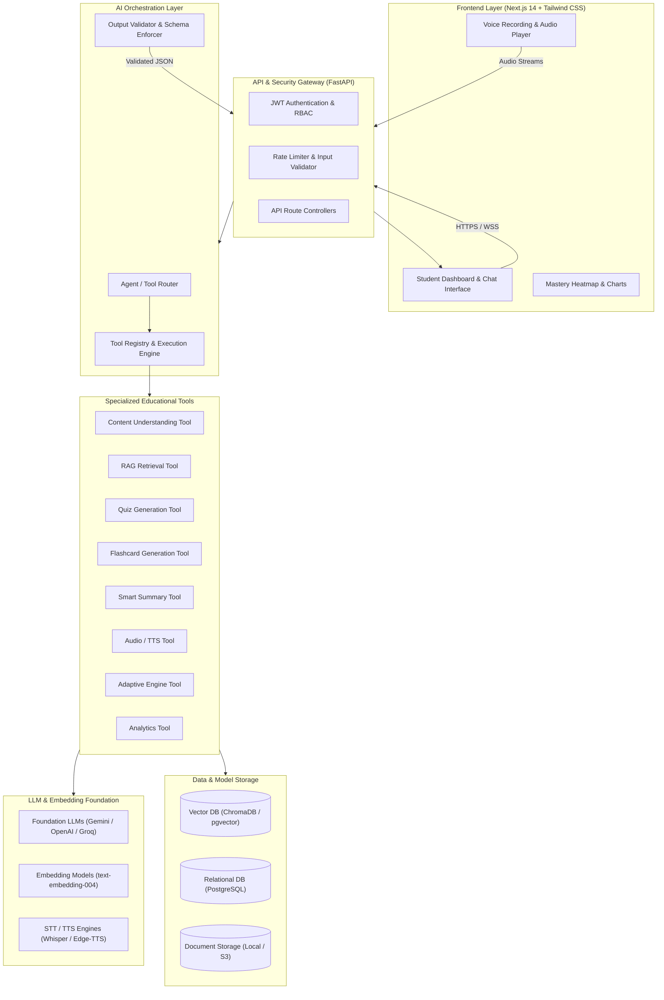
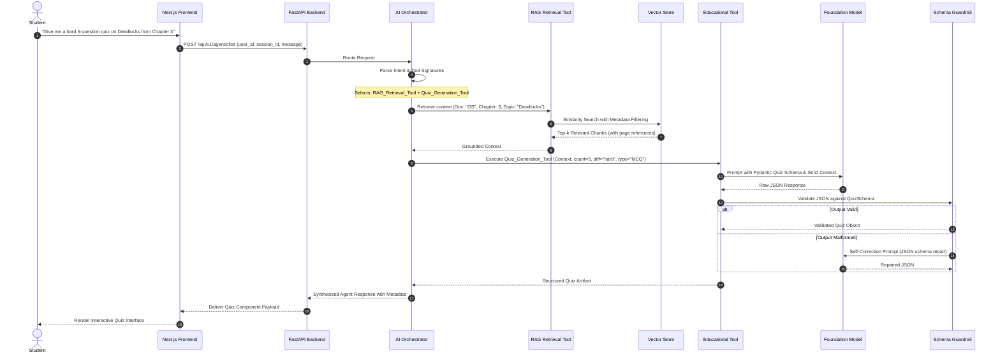
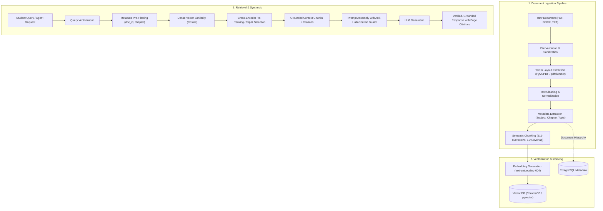
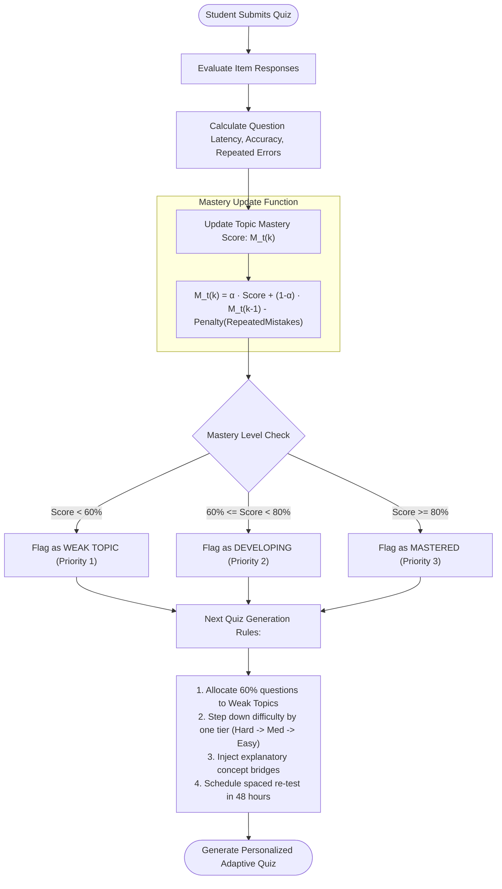
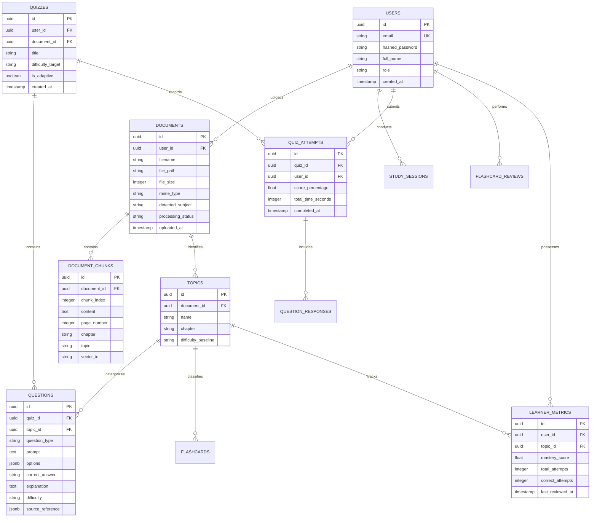
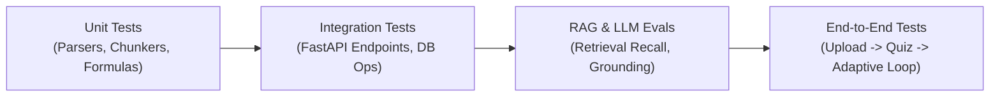
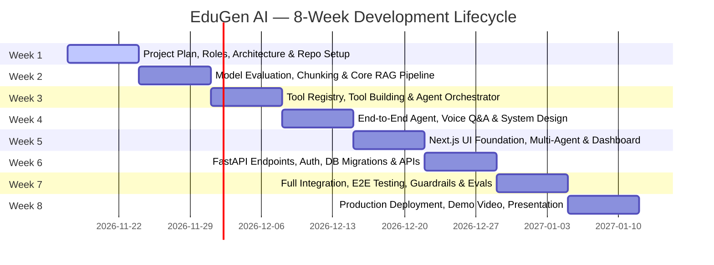

# EduGen AI — Master Project Plan & Architecture Specification
**Track B (Advanced Track) Project Specification**  
**Document Version:** 1.0.0 | **Date:** November 2026  
**Project:** Educational Content Generator AI ("EduGen AI")  
**Target Delivery Window:** 8-Week Accelerated Academic/Production Milestone  

---

## 1. Project Vision

**EduGen AI** is an intelligent, agentic personalized learning platform designed to transform static, passive educational materials (such as university textbooks, lecture syllabi, lecture slides, and personal course notes) into an active, adaptive, multimodal study companion.

Unlike conventional "PDF-to-chatbot" or naive "PDF-to-quiz" wrappers that merely pass entire text blocks to a single prompt, EduGen AI implements a **multi-tool agent orchestration architecture** operating over a robust **Retrieval-Augmented Generation (RAG)** pipeline. The platform empowers students to:
- Deeply understand complex curricular concepts grounded strictly in their uploaded course syllabi.
- Engage in interactive multi-turn conceptual inquiry via text and voice.
- Generate structured, multi-difficulty assessment materials (quizzes, flashcards, conceptual summaries).
- Listen to spoken educational overviews tailored for auditory learners.
- Experience a closed-loop **Adaptive Learning Engine** that diagnoses knowledge gaps down to specific subtopics and dynamically restructures subsequent study cycles.
- Monitor mastery via an actionable, non-decorative Learning Analytics Dashboard.

The driving operational philosophy is:
$$\text{UPLOAD} \longrightarrow \text{UNDERSTAND} \longrightarrow \text{LEARN} \longrightarrow \text{PRACTICE} \longrightarrow \text{ANALYZE} \longrightarrow \text{ADAPT}$$

---

## 2. Problem Statement

Modern learners face four critical bottlenecks when working with high-volume technical and academic course materials:
1. **Passive Consumption Inefficacy:** Reading 50-to-100-page academic documents leads to poor cognitive retention without continuous active recall and spaced self-testing.
2. **Generic, Ungrounded AI Hallucinations:** Off-the-shelf generative AI assistants frequently invent theoretical facts, fabricate citations, and fail to align with a university's specific syllabus or professor's nomenclature.
3. **Static, Non-Adaptive Question Banks:** Existing quiz tools generate one-off static multiple-choice questions without tracking past failures, resulting in questions that are either trivially simple or inappropriately frustrating.
4. **Disjointed Learning Tools:** Students are forced to juggle disconnected tools: one for PDF reading, another for flashcard spaced repetition (Anki), another for AI summaries, and another for auditory learning, with zero unified analytics tracking conceptual mastery.

**EduGen AI** solves this by uniting contextual semantic document processing, agentic tool orchestration, grounded retrieval, dynamic student skill modeling, and multimodal presentation into a single, cohesive educational workspace.

---

## 3. Target Users & Personas

### 3.1 Primary Personas
- **University Undergraduate & Graduate Students (e.g., Computer Science, Engineering, Medicine, Law):**
  - *Context:* Absorbing hundreds of pages of lecture slides, textbook chapters, and research papers weekly.
  - *Goal:* Rapidly extract core topic hierarchies, test conceptual understanding before midterm exams, and identify specific subtopics where their recall fails.
- **Self-Directed Technical Learners & Certification Candidates (e.g., AWS, PMP, CFA, GATE):**
  - *Context:* Preparing for high-stakes standardized exams using dense technical manuals.
  - *Goal:* Spaced repetition flashcards, automated diagnostic mock quizzes, and exam-focused executive summaries.
- **Educators & Teaching Assistants:**
  - *Context:* Generating balanced diagnostic quizzes, homework problem sets, and review outlines directly from assigned course handouts.

### 3.2 Project Success Criteria
The project's success is evaluated across technical, pedagogical, and user-experience benchmarks:
1. **Retrieval Precision & Grounding:**
   - $\ge 90\%$ of generated questions, summaries, and chat responses cite accurate, verifiable source document pages.
   - Zero hallucinated assertions when queried with out-of-scope or uncontained curriculum questions (graceful fallback triggered).
2. **End-to-End Latency & Responsiveness:**
   - Ingestion and chunk indexing of a standard 25-page PDF completed in $< 15$ seconds.
   - Streaming assistant response Time To First Token (TTFT) $< 1.2$ seconds.
   - 5-question multi-difficulty quiz generation completed in $< 4.5$ seconds.
3. **Adaptive Skill Modeling Efficacy:**
   - Verified dynamic recalibration: when a student scores $<60\%$ on a topic, subsequent quizzes automatically weight that topic $\ge 50\%$ with stepped-down difficulty.
   - Real-time updates reflected in the Student Dashboard mastery heatmap within 1 second of quiz submission.
4. **Structured Schema Integrity:**
   - $100\%$ of tool outputs conform to strict Pydantic validation schemas, with automated self-correction preventing UI crashes.
5. **Portfolio & Demonstration Quality:**
   - Polished, responsive Next.js 14 interface free of visual clutter or generic template artifacts.
   - Successful execution of the full live demo script (Upload $\rightarrow$ Q&A $\rightarrow$ Diagnostic Quiz $\rightarrow$ Mistake Analysis $\rightarrow$ Adaptive Recalibration $\rightarrow$ Audio Lesson).

---

## 4. Functional Requirements

### 4.1 Document Ingestion & Understanding
- **FR-1.1 Multi-format Parsing:** Support `.pdf`, `.docx`, and `.txt` files up to 25 MB.
- **FR-1.2 Structure & Hierarchy Detection:** Automatically detect document metadata, subject, chapters, topics, subtopics, and difficulty tier.
- **FR-1.3 Content Grounding:** Store granular chunk references (page number, chapter, chunk index) for every ingested item.

### 4.2 Agentic Study Assistant & Chat
- **FR-2.1 Contextual Question-Answering:** Answer student queries grounded strictly in uploaded documents.
- **FR-2.2 Explainability Modes:** Support specialized pedagogical prompts ("Explain like I'm a beginner", "Exam-focused deep dive", "Give concrete real-world examples", "Explain why my answer was wrong").
- **FR-2.3 Explicit Source Attribution:** Provide clickable citation references indicating the exact source document, chapter, and page.
- **FR-2.4 Anti-Hallucination Fallback:** Explicitly state when requested information is absent from uploaded materials rather than hallucinating external facts.

### 4.3 Educational Assessment Generation
- **FR-3.1 Multi-Type Quizzes:** Generate Multiple Choice Questions (MCQs), True/False questions, and Fill-in-the-Blank questions.
- **FR-3.2 Difficulty Calibration:** Support calibrated difficulty tiers: Easy, Medium, and Hard.
- **FR-3.3 Strict Question Schemas:** Every question must include prompt text, options, correct answer key, pedagogical explanation, topic tag, difficulty rating, and source citation.
- **FR-3.4 Interactive Flashcards:** Generate two-sided study cards (Front: Prompt/Concept, Back: Core answer & explanation) with confidence ratings and Leitner-style review status.
- **FR-3.5 Smart Summaries:** Produce three distinct summary modes: Quick Overview (5-minute read), Detailed Conceptual Breakdown, and Exam Cram / High-Yield Key Points.

### 4.4 Advanced Multimodal & Audio Learning
- **FR-4.1 Text-to-Speech (TTS):** Convert educational summaries and concept explanations into natural synthesized speech.
- **FR-4.2 Audio Controls:** Provide browser playback controls (play/pause, timeline scrubber, playback speed $0.75\times - 2.0\times$, transcript sync).
- **FR-4.3 Voice Q&A (Advanced Track):** Enable voice input via Speech-to-Text (STT), pipe transcript to the agent orchestrator, and deliver dual text/audio responses.

### 4.5 Closed-Loop Adaptive Learning & Analytics
- **FR-5.1 Learner Skill Modeling:** Quantify student mastery per topic and subtopic based on accuracy, response latency, attempt counts, and repeated errors.
- **FR-5.2 Dynamic Quiz Adjustment:** Automatically configure subsequent quizzes to focus on weak topics ($<65\%$ accuracy) at lower initial difficulty before laddering up.
- **FR-5.3 Comprehensive Analytics:** Visualize mastery heatmaps, score progression trends, topic radar charts, study streaks, and actionable next-study recommendations.

---

## 5. Non-Functional Requirements (NFRs)

| Category | Requirement Specification |
| :--- | :--- |
| **Response Latency** | Streaming chat TTFT (Time To First Token) $< 1.2$s; standard retrieval $< 400$ms; quiz generation (5 questions) $< 4.5$s. |
| **Grounding & Accuracy**| $> 95\%$ factual alignment with source text; zero hallucinated citations; explicit "out of scope" detection. |
| **System Reliability** | Graceful degradation on LLM rate limits; circuit breakers for third-party APIs; automated retries on malformed JSON outputs. |
| **Security & Privacy** | Strict tenant isolation (users access only their own documents); bcrypt password hashing; short-lived JWT tokens; sanitization of uploaded files. |
| **Usability & Design** | Modern, responsive educational SaaS UI (desktop, tablet, mobile); WCAG 2.1 AA accessibility compliant; dark/light theme support. |

---

## 6. Track B (Advanced Track) Differentiating Requirements

As an **Advanced Track (Track B)** project, EduGen AI goes beyond standard single-prompt LLM wrappers through five core architectural pillars:

1. **Autonomous Tool Selection & Routing:** A centralized AI Orchestrator receives raw student intent, determines required tool calls (e.g., distinguishing between a general conceptual question, a request for a targeted quiz, or an analytics diagnosis), executes tools with structured arguments, validates outputs, and synthesizes answers.
2. **Strict RAG with Verifiable Source Citations:** Ingestion includes semantic chunking with overlap, metadata enrichment, embedding storage, reciprocal-rank fusion/hybrid retrieval, and mandatory attribution down to the document page number.
3. **Algorithmic Adaptive Learning Engine:** A deterministic-plus-probabilistic learner model that maintains an evolving topic-mastery graph, shifting difficulty and topic distributions based on historical performance.
4. **Voice Q&A Pipeline:** Full conversational voice loop integrating client audio capture, Speech-to-Text (STT), agent reasoning over RAG, and synchronized Text-to-Speech (TTS) playback with full text fallback.
5. **Production-Grade Full-Stack Architecture:** Decoupled FastAPI backend with asynchronous endpoints, PostgreSQL relational storage with Alembic migrations, vector database persistence, and a type-safe Next.js (TypeScript + Tailwind CSS) frontend.

---

## 7. System Architecture Overview



---

## 8. Agent & Tool Architecture

The agent orchestrator operates on a ReAct (Reasoning + Acting) / Tool-Calling paradigm. When a user input arrives, the orchestrator executes the following workflow:



### 8.1 Tool Registry Specifications
1. **`ContentUnderstandingTool`**: Analyzes newly uploaded raw text to extract a complete syllabus tree: Subject $\rightarrow$ Modules $\rightarrow$ Chapters $\rightarrow$ Topics $\rightarrow$ Key Concepts.
2. **`RAGRetrievalTool`**: Queries the vector index using dense semantic embeddings with metadata pre-filtering (by `document_id`, `chapter`, `difficulty`).
3. **`QuizGenerationTool`**: Generates pedagogical questions conforming strictly to the `QuizSchema` (MCQ, True/False, Fill-in-Blank).
4. **`FlashcardGenerationTool`**: Generates atomic revision cards formatted for Leitner spaced repetition.
5. **`SummaryGenerationTool`**: Synthesizes structured digests across three modes (Quick, Detailed, Exam Cram).
6. **`AudioLearningTool`**: Synthesizes clear auditory narrations from generated summaries with duration and chapter cue markers.
7. **`AdaptiveDifficultyTool`**: Inspects student topic accuracy history and returns recommended difficulty levels and target topic distributions for the next assessment.
8. **`StudyRecommendationTool`**: Compiles actionable revision prescriptions based on identified weak knowledge nodes.

---

## 9. RAG Pipeline Architecture



### 9.1 Chunking Strategy & Metadata Schema
- **Chunk Size:** 512 to 800 tokens with 100-token sliding window overlap to preserve semantic continuity across paragraph boundaries.
- **Stored Metadata per Chunk:**
  ```json
  {
    "chunk_id": "doc_8f9a2b_c003_p042_001",
    "document_id": "doc_8f9a2b",
    "filename": "Operating_Systems_Silberschatz.pdf",
    "subject": "Computer Science",
    "chapter": "Chapter 7: Deadlocks",
    "topic": "Banker's Algorithm",
    "page_number": 42,
    "chunk_index": 1,
    "token_count": 648,
    "created_at": "2026-11-17T18:30:00Z"
  }
  ```

---

## 10. Adaptive Learning Engine Algorithm

The EduGen Adaptive Engine updates a dynamic Bayesian/Exponentially Weighted Moving Average (EWMA) model of the learner's mastery for every distinct concept node.



### 10.1 Mathematical Formulation
For topic $T$ at review step $k$:
$$M_{T, k} = \alpha \cdot \text{Accuracy}_k + (1 - \alpha) \cdot M_{T, k-1} - \lambda \cdot R_{\text{penalty}}$$
Where:
- $\alpha = 0.35$ (learning rate weighting recent attempts).
- $R_{\text{penalty}}$ scales with consecutive failed attempts on the same core concept.
- If $M_{T} < 0.60$, the system automatically locks target quiz difficulty at **Easy** or **Medium** and flags the topic in the student's revision queue.
- Once $M_{T} \ge 0.85$ over two consecutive sessions, the topic difficulty advances to **Hard**.

---

## 11. Relational Database Schema (PostgreSQL)



---

## 12. Frontend & Visual Design System

### 12.1 Visual Identity: "EduGen AI"
- **Design Philosophy:** Minimalist, academic, focused, and high-clarity. Zero distracting clutter, zero decorative pseudo-charts.
- **Color Tokens:**
  - *Primary / Accent:* Deep Indigo (`#4F46E5` / Tailwind `indigo-600`) — represents intellect and focus.
  - *Success / Mastery:* Emerald (`#10B981` / Tailwind `emerald-500`) — represents mastered topics.
  - *Warning / Review:* Amber (`#F59E0B` / Tailwind `amber-500`) — represents developing topics.
  - *Critical / Weak:* Crimson (`#EF4444` / Tailwind `red-500`) — represents high-priority weak areas.
  - *Neutrals:* Slate (`#0F172A` down to `#F8FAFC`).
- **Typography:** Inter or Plus Jakarta Sans for clean legibility at all viewport scales.

### 12.2 Responsive Page Structure
1. **Landing & Authentication (`/`, `/login`, `/register`):** Product value proposition, feature preview, secure login.
2. **Student Command Dashboard (`/dashboard`):**
   - High-level KPIs: Overall Mastery Score, Streak Counter, Total Study Hours, Quizzes Completed.
   - Topic Mastery Heatmap: Visual gradient representation of concept readiness.
   - Weak Areas & Action Cards: One-click "Reinforce Weakest Topic" triggers.
   - Recent Activity & Document Library shortcuts.
3. **Document Workspace (`/documents`):** File drag-and-drop, parsing status indicator, detected topic outline, and source explorer.
4. **AI Study Assistant (`/assistant`):** Multi-turn chat interface with educational quick-action chips, source pill citations, and voice input toggle.
5. **Interactive Quiz Station (`/quiz/[id]`):** Timed question runner, progress bar, instant pedagogical feedback upon completion, and topic weakness breakdown.
6. **Flashcard Deck (`/flashcards`):** 3D card-flip animation, confidence rating buttons (Hard, Good, Easy), and Leitner queue progress.
7. **Audio Learning Lab (`/audio`):** Dynamic waveform visualizer, synchronized transcript, audio playback speed, and chapter jumpers.
8. **Deep Analytics (`/analytics`):** Radar chart of subject dimensions, score history line charts, and time distribution metrics.

---

## 13. Backend Architecture & API Specifications

Built with **FastAPI**, leveraging asynchronous endpoints, dependency injection for database sessions and authentication, and strict Pydantic schemas.

### 13.1 Directory Organization
```
backend/
├── app/
│   ├── main.py              # Application entry point, middleware & route mounting
│   ├── api/                 # Endpoint routers (v1)
│   │   ├── auth.py          # User registration, login, token refresh
│   │   ├── documents.py     # Upload, ingestion status, document metadata
│   │   ├── agent.py         # AI study assistant chat & tool orchestration
│   │   ├── quiz.py          # Quiz generation, submission, and grading
│   │   ├── flashcards.py    # Flashcard deck generation and review tracking
│   │   ├── summary.py       # Multi-mode summary generation
│   │   ├── audio.py         # TTS generation and audio streaming
│   │   └── analytics.py     # Learner metrics, heatmaps, recommendations
│   ├── agents/              # Orchestration logic, ReAct loops & routing
│   ├── tools/               # Modular tool definitions matching agent schemas
│   ├── rag/                 # Ingestion, parsing, chunking, embeddings, retrieval
│   ├── models/              # SQLAlchemy ORM database models
│   ├── schemas/             # Pydantic v2 validation models
│   ├── services/            # Business logic (adaptive engine, file handling)
│   ├── database/            # Database session, base model & engine setup
│   ├── auth/                # JWT verification, password hashing, security deps
│   └── utils/               # Audio helpers, text cleaners, logger setup
├── alembic/                 # Database migration scripts
├── requirements.txt         # Pinned Python dependencies
└── tests/                   # Automated unit and integration tests
```

### 13.2 Core API Endpoints
- `POST /api/v1/auth/register` — User account registration
- `POST /api/v1/auth/login` — Authentication & JWT issue
- `POST /api/v1/documents/upload` — Multipart file upload and asynchronous RAG ingestion
- `GET  /api/v1/documents` — List user's processed documents
- `GET  /api/v1/documents/{id}/hierarchy` — Get detected topics and chapter tree
- `POST /api/v1/agent/chat` — Contextual AI chat query with source citations
- `POST /api/v1/quiz/generate` — Generate structured quiz (custom or adaptive)
- `POST /api/v1/quiz/submit` — Submit quiz attempt, calculate score, trigger adaptive engine update
- `POST /api/v1/flashcards/generate` — Generate review flashcard deck
- `POST /api/v1/flashcards/review` — Submit spaced repetition review rating
- `POST /api/v1/summary/generate` — Create Quick, Detailed, or Exam Cram summary
- `POST /api/v1/audio/generate` — Synthesize TTS audio from educational summary
- `GET  /api/v1/analytics/dashboard` — Retrieve aggregate student mastery and weak topics
- `GET  /api/v1/health` — System status, DB connectivity, and model availability

---

## 14. Security & Guardrails

1. **Strict Input Sanitization:**
   - File extension whitelisting (`.pdf`, `.docx`, `.txt`) and MIME type inspection.
   - Enforce 25 MB file size limit to prevent Denial of Service (DoS) memory exhaustion.
   - Sanitize text inputs against prompt injection attacks (strip system prompt override delimiters).
2. **Access Control & Multi-Tenancy:**
   - Strict document ownership checks: a user cannot query or retrieve chunks belonging to another user.
   - Standardized JWT authentication with 60-minute expiration and secure HTTP-only refresh tokens.
3. **RAG Grounding & Anti-Hallucination:**
   - System prompts enforce strict boundary: *"You are an academic tutor strictly bounded by the provided context. If the source material does not contain the answer, reply: 'I cannot find this information in your uploaded materials.'"*
   - Retrieval similarity score thresholding: If $\text{sim}(q, d) < 0.65$, fail safely without fabricating context.
4. **Structured Output Enforcement:**
   - All tool responses (quizzes, flashcards, metadata) are validated against Pydantic models with automated retry on JSON syntax degradation.

---

## 15. Testing & Verification Strategy

The testing matrix covers four distinct operational tiers:



### 15.1 Edge Case Verification Matrix
- **Corrupt / Empty PDFs:** Verify that uploading a zero-byte or password-locked PDF returns HTTP 422 with a descriptive error message without crashing workers.
- **Scanned PDFs (No Text Layer):** Detect lack of parseable text and prompt the student to upload OCR-processed or text-native documents.
- **Large Technical Documents:** Validate chunking and indexing for 200+ page documents without worker memory timeouts.
- **Out-of-Scope Conceptual Questions:** Test that queries unrelated to the uploaded syllabus (e.g., asking about pop culture in an Operating Systems class) trigger the grounded fallback response.
- **Malformed LLM Output:** Inject synthetic malformed JSON into the Quiz Generator tool to verify automatic schema correction and retry mechanisms.

---

## 16. Deployment Strategy

- **Backend Service:** Containerized FastAPI application running via Uvicorn within Docker, deployable to Render, Railway, or AWS ECS.
- **Database & Storage:** Managed PostgreSQL instance (Supabase or AWS RDS) with persistent local or S3 object storage for uploaded files.
- **Vector Database:** Local persistent ChromaDB volume (development/MVP) with seamless configuration switch to `pgvector` in PostgreSQL for production.
- **Frontend Application:** Deployed seamlessly on Vercel with automated continuous deployment from the GitHub main branch.

---

## 17. 8-Week Master Delivery Roadmap



### 17.1 Detailed Weekly Milestones & Deliverables

#### **WEEK 1: Foundation, Architecture & Scope Definition (Current Week)**
- [x] Workspace inspection and clean directory skeleton setup.
- [x] Authoritative Master Project Plan (`docs/PROJECT_PLAN.md`).
- [x] Comprehensive, production-grade `README.md` with system design and Mermaid diagrams.
- [x] Problem statement, user personas, success criteria, and team role matrix.
- [x] Git repository initialization with standard `.gitignore` and `.env.example`.
- [x] Initial architectural baseline validation.

#### **WEEK 2: Model Benchmarking, Semantic Chunking & RAG Core**
- Compare and benchmark candidate LLMs (Gemini 1.5 Pro/Flash, GPT-4o-mini, Groq Llama-3.3-70B) for latency, cost, and educational structuring in `docs/MODEL_COMPARISON.md`.
- Benchmark candidate embedding models (`text-embedding-004`, `text-embedding-3-small`, BGE-small).
- Implement document parsers (PDF, DOCX, TXT), text normalization, and semantic chunking.
- Implement vector database indexing (ChromaDB) and metadata enrichment.
- Establish verified, grounded retrieval with source page attribution.

#### **WEEK 3: Modular Educational Tools & Agent Routing**
- Implement Tool Registry and base tool interfaces.
- Build Tool 1: Quiz Generator (MCQ, True/False, Fill-in-Blank with explanations).
- Build Tool 2: Flashcard Generator (Front/Back with Leitner status).
- Build Tool 3: Smart Summary Generator (Quick, Detailed, Exam Cram).
- Implement single-agent router to autonomously choose tools based on natural language intent.

#### **WEEK 4: Advanced Agent Orchestration & Voice Q&A Pipeline**
- Finalize end-to-end multi-turn agent conversation loop.
- Implement Voice Q&A feature (Speech-to-Text $\rightarrow$ Agent $\rightarrow$ RAG $\rightarrow$ Text/Audio response).
- Integrate Edge-TTS for high-quality audio summary generation with playback metadata.
- Implement comprehensive agent execution logging and telemetry.

#### **WEEK 5: Next.js Frontend Foundation & UI/UX Experience**
- Initialize Next.js 14 (App Router) with TypeScript and Tailwind CSS.
- Build design system tokens, typography, dark/light theme, and layout components.
- Develop interactive Student Dashboard (Mastery overview, streak counter, action cards).
- Develop Document Management interface with upload progress and syllabus tree viewer.
- Develop AI Study Assistant chat component with source pill citations.

#### **WEEK 6: Full Backend APIs, Authentication & Database Persistence**
- Complete FastAPI endpoints for auth, documents, agent chat, quizzes, flashcards, summaries, and audio.
- Implement JWT authentication, password hashing, and user document isolation.
- Configure PostgreSQL database with Alembic migration scripts.
- Implement session persistence, quiz attempt history logging, and telemetry.
- Publish interactive Swagger / OpenAPI documentation (`docs/API.md`).

#### **WEEK 7: Closed-Loop Adaptive Learning, Testing & Quality Guardrails**
- Implement dynamic Adaptive Learning Engine (`docs/ADAPTIVE_LEARNING.md`) connecting quiz failure analytics to subsequent quiz parameters.
- Build Student Analytics Dashboard with mastery heatmaps and topic radar charts.
- Implement automated Pydantic schema validation guardrails with self-healing retry logic.
- Execute edge-case testing suite (corrupt files, out-of-scope questions, rate-limit fallbacks).
- Optimize end-to-end latency (streaming tokens, retrieval caching).

#### **WEEK 8: Production Deployment, Demo Video & Final Presentation**
- Deploy backend service and PostgreSQL database to production cloud hosting.
- Deploy frontend application to Vercel with live environment configuration.
- Record high-impact 3–5 minute end-to-end video walkthrough showcasing:
  * Document upload $\rightarrow$ Topic extraction $\rightarrow$ Grounded Q&A $\rightarrow$ Quiz generation $\rightarrow$ Intentional failure $\rightarrow$ Adaptive quiz auto-generation $\rightarrow$ Audio summary.
- Complete Final Requirements Audit (`docs/FINAL_REQUIREMENTS_AUDIT.md`) and Known Limitations report (`docs/KNOWN_LIMITATIONS.md`).
- Finalize slide deck and project documentation for technical viva defense.

---

## 18. Team Roles & Individual Responsibility Matrix

```mermaid
flowchart TD
    subgraph Team ["EduGen AI Engineering Core"]
        Varun["VARUN D<br/>Lead AI/ML & Agent Architect"]
        Sindhuja["SINDHUJA S<br/>Lead Frontend & UI/UX Engineer"]
        Mohith["MOHITH S<br/>Lead Backend & Platform Engineer"]
    end

    Varun -->|Owns| A1["Agent Orchestrator & Tool Selection"]
    Varun -->|Owns| A2["RAG Pipeline & Embeddings"]
    Varun -->|Owns| A3["Adaptive Learning Mathematical Engine"]
    Varun -->|Owns| A4["Model Evaluation & Anti-Hallucination"]

    Sindhuja -->|Owns| F1["Next.js 14 App & TypeScript Architecture"]
    Sindhuja -->|Owns| F2["Visual Design System & Component Library"]
    Sindhuja -->|Owns| F3["Interactive Quiz, Flashcard & Audio UI"]
    Sindhuja -->|Owns| F4["Analytics Visualizations & Mastery Heatmaps"]

    Mohith -->|Owns| B1["FastAPI Application & Async Services"]
    Mohith -->|Owns| B2["PostgreSQL Schema, Migrations & ORM"]
    Mohith -->|Owns| B3["Authentication, Security & Rate Limiting"]
    Mohith -->|Owns| B4["Containerization, CI/CD & Cloud Deployment"]
```



### Detailed Ownership Breakdown

| Team Member | Core Focus Areas | Specific Primary Deliverables | Cross-Functional Overlap |
| :--- | :--- | :--- | :--- |
| **Varun D** | AI/ML Architecture & Agent Engineering | • AI Orchestrator & Tool Registry<br/>• Semantic chunking & RAG retrieval engine<br/>• Model benchmarking (`docs/MODEL_COMPARISON.md`)<br/>• Adaptive learning algorithm (`docs/ADAPTIVE_LEARNING.md`)<br/>• Output validation guardrails & retry logic | Collaborates with Mohith on API tool schemas; collaborates with Sindhuja on streaming chat and citation rendering. |
| **Sindhuja S** | Frontend Engineering & UI/UX Design | • Next.js 14 App Router + Tailwind setup<br/>• Design tokens, dark/light theme, typography<br/>• Student Dashboard & Topic Heatmap<br/>• Quiz Runner, Flashcard Deck & Audio Player UI<br/>• Responsive mobile/tablet/desktop layouts | Collaborates with Varun on voice audio controls and interactive quiz states; collaborates with Mohith on API client integration. |
| **Mohith S** | Backend Architecture & Infrastructure | • FastAPI project structure & dependency injection<br/>• PostgreSQL schema, models, and Alembic migrations<br/>• JWT Auth, file upload streaming, and security<br/>• REST API controllers (`docs/API.md`)<br/>• Docker containerization and cloud deployment | Collaborates with Varun on vector store persistence; collaborates with Sindhuja on endpoint contracts and error payloads. |

---

## 19. Risks & Mitigation Strategies

| Risk Description | Probability | Impact | Proactive Mitigation Strategy |
| :--- | :---: | :---: | :--- |
| **LLM Hallucination on Dense Technical Concepts** | Medium | High | Strict RAG prompt framing; minimum similarity thresholding ($>0.65$); mandatory citation mapping down to the exact page number; fallback to *"Not found in uploaded materials"*. |
| **LLM Output Format Degradation (Malformed JSON)** | High | Medium | Implement Pydantic schema validation at the tool boundary with an automated self-correcting retry loop that injects the validation error back to the model. |
| **API Rate Limits or Provider Outages** | Medium | Medium | Abstract LLM client into a provider-agnostic interface supporting seamless fallback across Google Gemini, OpenAI, and Groq. |
| **Cold-Start Problem in Adaptive Engine** | Low | Low | Seed initial student skill estimate with a standard baseline ($50\%$ neutral score); require at least one 5-question diagnostic before applying high-confidence adaptation. |
| **Scope Creep across 8-Week Timeline** | High | High | Strict enforcement of the weekly milestone gating system; features outside the core specification deferred to post-Week 8 future scope. |

---

## 20. Future Enhancements (Post-Milestone)

- **Collaborative Study Groups:** Real-time multi-user quiz battles and peer challenge modes.
- **Multimodal Diagram & Formula Understanding:** Direct extraction and visual Q&A over scientific charts, electrical schematics, and LaTeX equations.
- **Native Mobile Application:** React Native / Expo companion app for offline flashcard spaced repetition.
- **LMS Integration:** LTI (Learning Tools Interoperability) standard compliance for seamless plug-and-play with Canvas, Blackboard, and Moodle.
