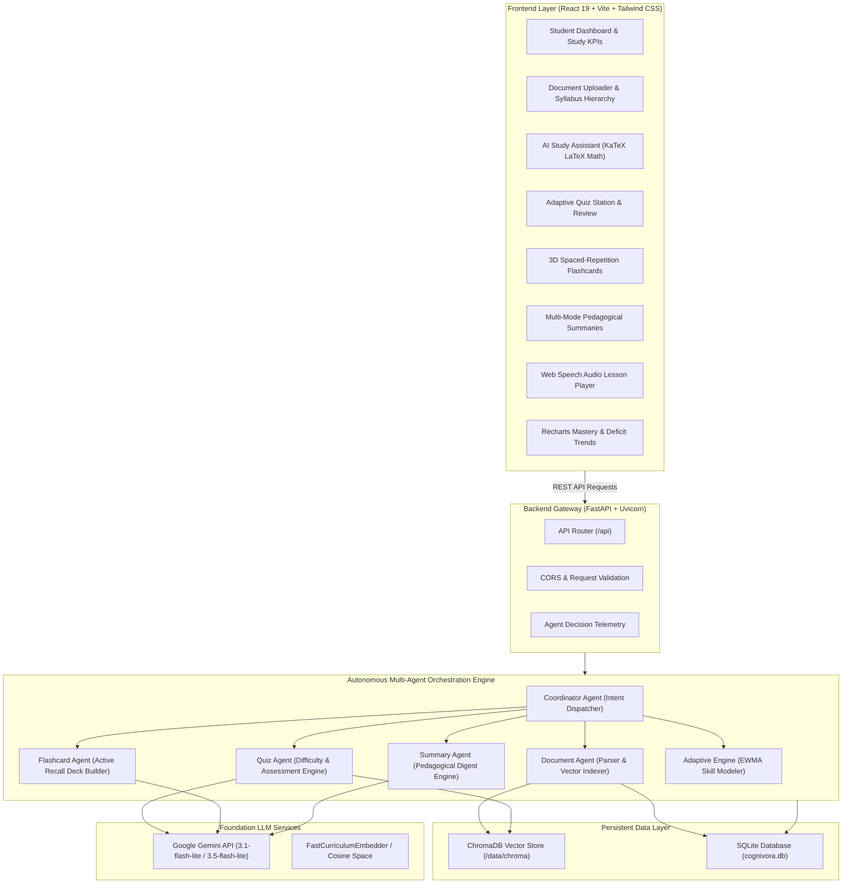
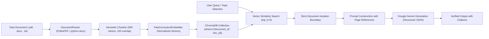
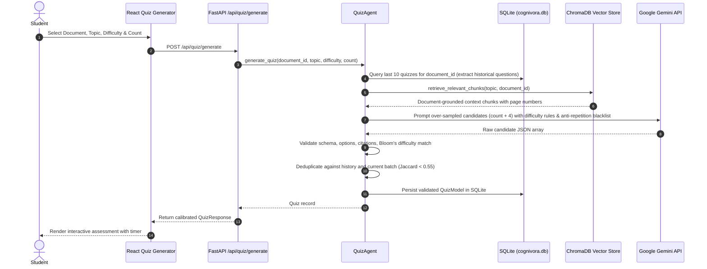

# Cognivora AI — System & Agent Architecture Specification

## 1. System Architecture Overview

Cognivora AI follows a decoupled, three-tier architecture comprising a modern React single-page application, a high-throughput FastAPI backend server, and an autonomous multi-agent orchestration layer connected to ChromaDB and Google Gemini.

---

## 2. Autonomous Multi-Agent Roles

| Agent | Core Responsibility | Implemented Logic |
| :--- | :--- | :--- |
| **Coordinator Agent** | Central dispatcher and intent classification | Classifies student inputs into Q&A, quiz requests, summary requests, or skill audits; coordinates tool execution and bundles citations. |
| **Document Agent** | Ingestion, parsing, and vector indexing | Extracts text from PDF, DOCX, and TXT; extracts syllabus topics; generates overlapping semantic chunks; embeds and persists vectors into ChromaDB. |
| **Quiz Agent** | Assessment generation and validation | Queries ChromaDB for topic-specific chunks; checks SQLite history to prevent repetitive questions; enforces Bloom's taxonomy difficulty criteria; validates candidate options, keys, and page citations. |
| **Flashcard Agent** | Active recall deck synthesis | Extracts high-yield terms, formulas, and operational mechanisms; generates front/back cards with difficulty calibration. |
| **Summary Agent** | Pedagogical condensation | Produces 5 distinct summary modes tailored to student cognitive needs: Executive Brief, Detailed Notes, Key Takeaways, Beginner Analogy, and Exam Cram. |
| **Adaptive Learning Engine** | Student skill and mastery modeling | Tracks historical quiz attempts in SQLite; computes Exponentially Weighted Moving Average (EWMA) topic scores; flags topics $<60\%$ as critical deficits. |

---

## 3. RAG (Retrieval-Augmented Generation) Pipeline

### RAG Boundary & Isolation Guarantees
- **Strict Document ID Partitioning:** Vector queries always pass `where={"document_id": document_id}`.
- **Cross-Contamination Guard:** If semantic search returns fewer than 2 chunks, direct chunk fetching is restricted strictly to chunks belonging to `document_id`. Chunks from any other document are discarded at the retrieval boundary.
- **Verifiable Page Citations:** Every retrieved chunk preserves its original document page index (`Page X, <filename>`), ensuring that all answers and questions reference verifiable source material.

---

## 4. Assessment Generation & Anti-Repetition Pipeline

---

## 5. Backend/Frontend Integration

- **Frontend-Backend Contract:** Typed Pydantic v2 schemas mirror React state objects (`QuizQuestion`, `QuizResponse`, `DocumentResponse`, `ChatMessageResponse`).
- **Proxy Rewrites:** `frontend/vercel.json` transparently proxies all requests from `/api/*` to `https://cognivora-backend.onrender.com/api/*`, eliminating CORS complexities in production.
- **Client Resilience:** React frontend includes standard retry logic, loading spinners, and dismissible alert banners for clean UX during cold starts or transient API rate limits.
